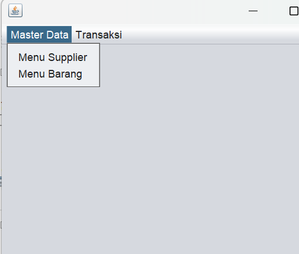
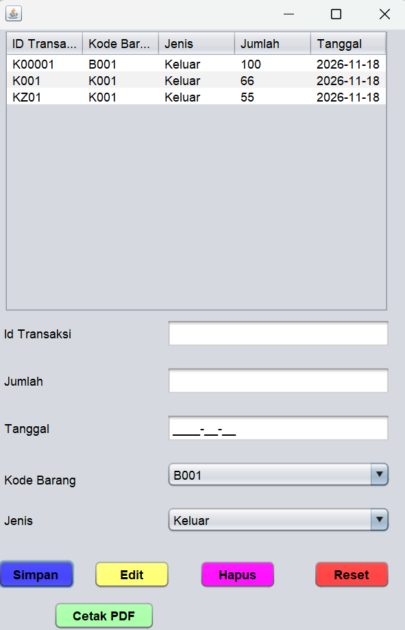
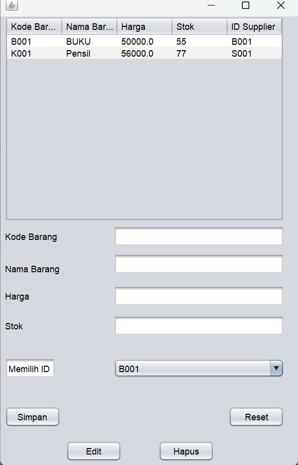
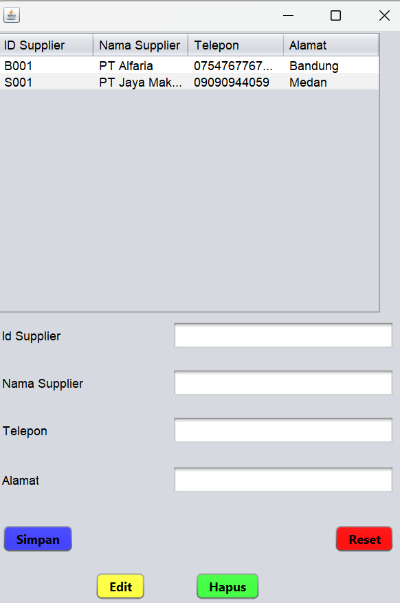
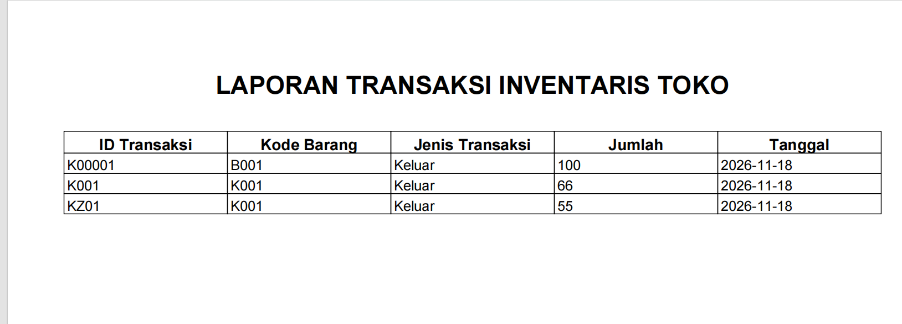

# 📦 Sistem Inventaris Toko (Java Swing & MySQL)

[](https://www.oracle.com/java/)
[](https://www.mysql.com/)
[](https://netbeans.apache.org/)


## 📸 Tangkapan Layar Aplikasi

### 1. Menu Utama


### 2. Form Transaksi


### 3. Form Barang & Supplier



### 4. Hasil Laporan PDF



Aplikasi *desktop* manajemen inventaris toko berbasis **Java Swing** yang dirancang secara sistematis untuk mengelola operasional data harian secara terstruktur. Dikembangkan menggunakan **NetBeans IDE** dan database **MySQL**, aplikasi ini menerapkan arsitektur modular multi-form yang mencakup manajemen data master (*Supplier* dan *Barang*), pencatatan transaksi terstandarisasi, serta generator pelaporan otomatis berbasis **iText 5**.

---

## 🏗️ Arsitektur & Penjelasan Modul Sistem

Sistem ini dibangun dengan memisahkan fungsi operasional ke dalam beberapa *form* dan kelas penunjang guna menjaga kerapian kode (*clean code*):

1. **Modul Koneksi Database (`Koneksi.java`)**
   - Bertindak sebagai jembatan tunggal (*centralized connection*) menggunakan **JDBC Driver** untuk menghubungkan aplikasi Java Swing dengan server database MySQL lokal di XAMPP (`com.mysql.cj.jdbc.Driver`).
2. **Modul Pengelolaan Supplier (`FormSupplier.java`)**
   - Menyediakan antarmuka CRUD lengkap (*Create, Read, Update, Delete*) untuk entitas `tb_supplier`. Dilengkapi dengan fungsi pembersihan form otomatis dan penyegaran tabel (*refresh JTable*) secara *real-time*.
3. **Modul Pengelolaan Barang (`FormBarang.java`)**
   - Mengatur data inventaris produk, harga satuan, dan kuantitas stok. Memiliki relasi langsung dengan `tb_supplier` untuk memastikan setiap barang terikat pada pemasok yang valid.
4. **Modul Transaksi Masuk/Keluar (`FormTransaksi.java`)**
   - Inti operasional pencatatan arus barang. Menggunakan komponen **`JFormattedTextField`** dengan pemformatan masker tanggal (`####-##-##`) untuk memastikan standar input selalu konsisten (`YYYY-MM-DD`), menghindari kesalahan format saat data disimpan ke database.
5. **Modul Pelaporan PDF (`CetakLaporan.java`)**
   - Mengintegrasikan pustaka **iText 5** (`itextpdf-5.5.13.jar`) untuk memproses rekapitulasi data dari tabel `tb_transaksi` secara dinamis ke dalam dokumen berformat PDF (`.pdf`) yang tersimpan otomatis di direktori kerja proyek.

---

## 🗄️ Skema Relasi Database (`db_inventaris`)

Struktur basis data dirancang menggunakan relasi normalisasi standar untuk menjaga integritas data antar tabel:

* **`tb_supplier`** (Data Master Pemasok)
  - `id_supplier` (Primary Key, VARCHAR/INT)
  - `nama_supplier` (VARCHAR)
  - `alamat` (TEXT)
  - `telepon` (VARCHAR)

* **`tb_barang`** (Data Master Produk & Stok)
  - `kode_barang` (Primary Key, VARCHAR)
  - `nama_barang` (VARCHAR)
  - `kategori` (VARCHAR)
  - `harga` (DOUBLE/INT)
  - `stok` (INT)
  - `id_supplier` (Foreign Key merujuk ke `tb_supplier`)

* **`tb_transaksi`** (Catatan Arus Barang Masuk/Keluar)
  - `id_transaksi` (Primary Key, VARCHAR/INT)
  - `kode_barang` (Foreign Key merujuk ke `tb_barang`)
  - `jenis_transaksi` (ENUM / VARCHAR: *Masuk* / *Keluar*)
  - `jumlah` (INT)
  - `tanggal` (DATE - format terstandarisasi `YYYY-MM-DD`)

---

## 🚀 Panduan Instalasi & Pengoperasian Teknis

### Prasyarat Sistem
* Terinstal **Java Development Kit (JDK 8 atau versi di atasnya)**.
* Terinstal **NetBeans IDE** (disarankan versi 12+).
* Terinstal **XAMPP Control Panel** (modul Apache & MySQL aktif).

### Langkah-langkah Setup:
1. **Clone Repository:**
   ```bash
   git clone [https://github.com/henricofernando18/Sistem-Inventaris-Toko.git](https://github.com/henricofernando18/Sistem-Inventaris-Toko.git)
